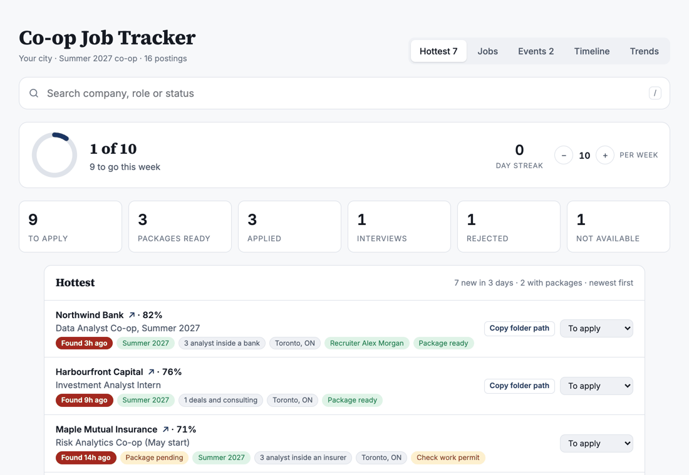
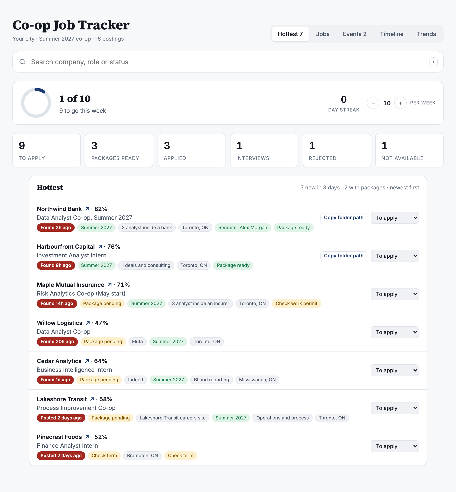
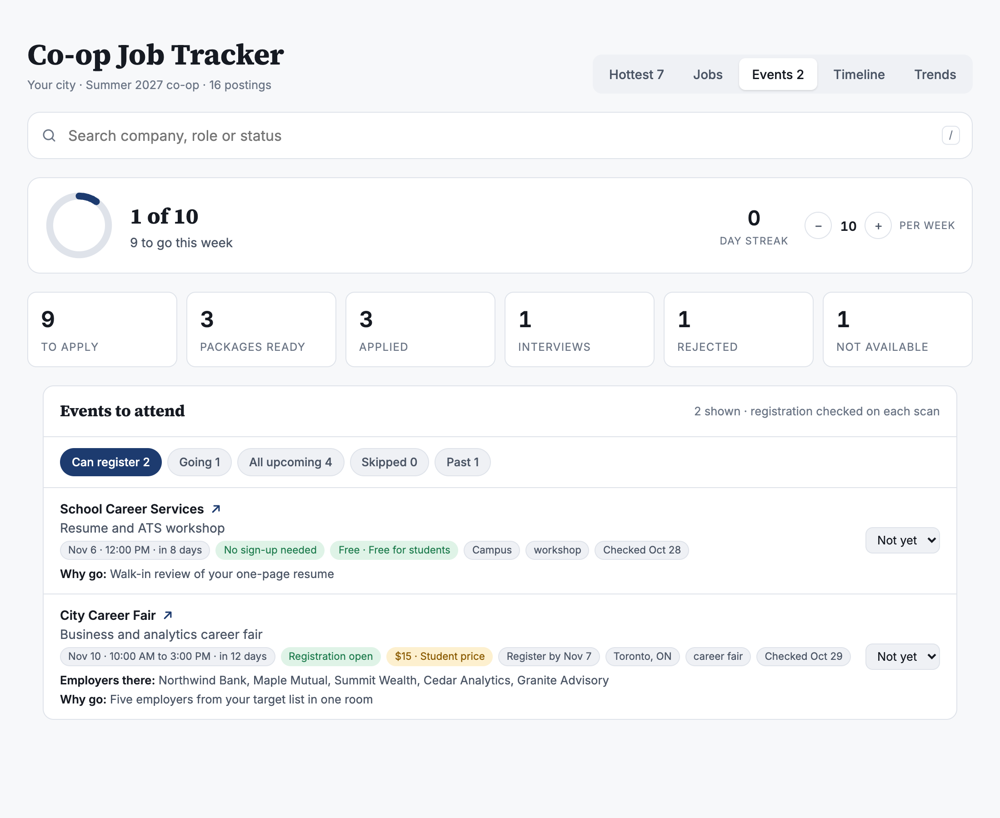
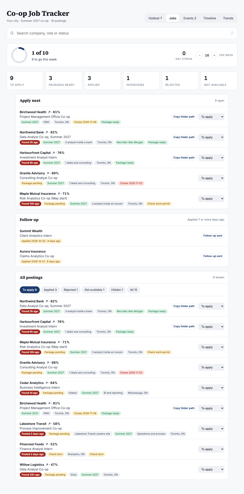
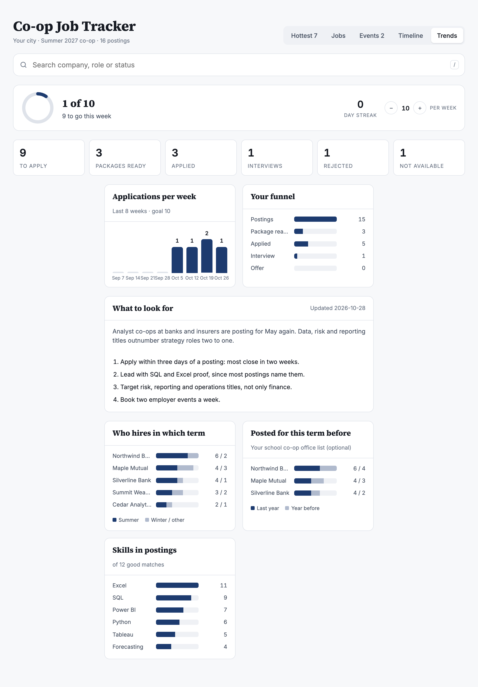
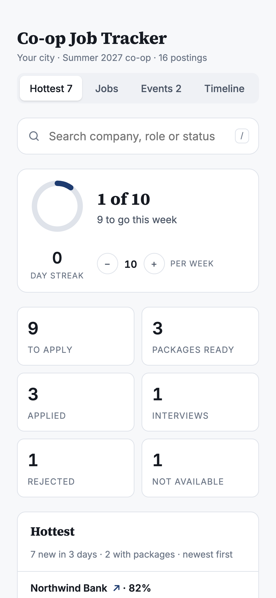

# Co-op Job Tracker

A one-page tracker for a student co-op search. It puts the **newest postings first** (you apply when you are one of the first), shows which ones already have an application package ready, and keeps your applications, follow-ups and employer events in one place.



**Try it now:** open `index.html` in a browser (or run `python3 -m http.server` in this folder and visit `localhost:8000`). It starts with made-up postings, so you can click everything. Your clicks are saved in your browser only.

## What it does

| Tab | What it is for |
|---|---|
| **Hottest** | Postings found or posted in the last 3 days, newest first, with a "Package ready" or "Package pending" tag. This is the tab to open first. |
| **Jobs** | Everything: apply-next list, follow-ups due after 7 days, filters for To apply, Applied, Rejected, Not available and Hidden, and search. |
| **Events** | Info sessions, fairs and coffee chats with registration state, cost, who you will meet and why to go. |
| **Timeline** | What you did and when, newest first. |
| **Trends** | Who is hiring, which skills postings ask for, and a short market read. |

Also: a weekly application goal with a streak, and light and dark themes.

| Hottest | Events |
|---|---|
|  |  |

| Jobs | Trends | Phone |
|---|---|---|
|  |  |  |

## Why I built it

Most postings close within two weeks, and I was losing time to copying the same details between tabs. I wanted one page that shows what is new, what I have already prepared and what I have applied to. I built it with Claude Code and use it every day in my own search. I can explain how every part works, and `docs/how-it-works.md` walks through it.

## Make it yours (5 minutes)

1. Open `index.html` and edit the three values in `CONFIG` near the top of the script: your city, your term and the chip label.
2. Replace the made-up postings in `demo-db.js` (the `SEED` object) with your own. The fields are in `docs/data-model.md`.
3. Optional: swap `demo-db.js` for a real shared database (Firebase, Supabase or a small API). The page only calls `collection(name).onSnapshot(cb)`, `doc(path).onSnapshot(cb)` and `doc(path).update(fields)`.

## How the "hot" part works

A posting is hot when it is not applied, not hidden, scores 40 or more and was found or posted in the last 72 hours. The age comes from `firstSeen` (a timestamp your scan sets when it adds the posting) or, if that is missing, the posted date. See `isHot()` in `index.html`.

## How the score works (example method)

The 0 to 100 score in the sample data comes from a simple rubric you can copy and change: role fit with your target lanes, a match on your real skills, the term and start date matching yours, and a small bonus for employers on your priority list. Strong is 70 and up, maybe is 50 to 69, under 40 is hidden. Details and the term check are in `docs/how-it-works.md`.

## What is not in this repo, on purpose

- **No scrapers or automation that read LinkedIn, Indeed or other job sites.** Their terms do not allow it, and I do not want to push anyone toward getting their account restricted. Add postings by hand, from your own searches, or with a tool you are allowed to use.
- **No personal data.** The postings, events and names in the demo are made up.
- **No resume or cover letter files.**

## Rebuild the screenshots

```bash
pip install playwright pillow
python tools/capture.py
```

## Files

```
index.html        the whole page (HTML, CSS and JavaScript, no build step)
demo-db.js        sample data and a small localStorage database
docs/             how it works, data model and screenshots
tools/capture.py  rebuilds the screenshots and the demo GIF
```

MIT License, see `LICENSE`.
